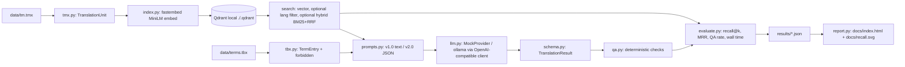

# tm-rag-copilot

A small, honest, fully offline demo of retrieval-augmented translation: it embeds a synthetic translation memory and term base, retrieves the closest segments by meaning, translates with a local model or a deterministic mock, and checks every output with deterministic QA, then measures itself on a gold set.

97.6% of translations passed automated QA with a local Qwen model, against 80.5% for the retrieval-only baseline.

**简体中文摘要:** 这是一个完全离线运行的小型演示项目:它把一份虚构的翻译记忆(TMX)和术语库(TBX)向量化存入本地 Qdrant,按语义检索最相似的句段,用本地模型(或确定性 mock)生成译文,用确定性规则做自动 QA,并在一组标准查询上测量检索召回率和 QA 通过率。所有数据都是为本项目虚构的。

**繁體中文摘要:** 這是一個完全離線運行的小型示範專案:它把一份虛構的翻譯記憶(TMX)和術語庫(TBX)向量化存入本地 Qdrant,依語義檢索最相似的句段,用本地模型(或確定性 mock)產生譯文,以確定性規則做自動 QA,並在一組標準查詢上測量檢索召回率與 QA 通過率。所有資料都是為本專案虛構的。



See the full measured results page, generated from `results/*.json`: [docs/index.html](docs/index.html).

## What it does

1. Parse `data/tm.tmx` (TMX 1.4) into translation units and `data/terms.tbx` (TBX) into term entries with forbidden alternatives.
2. Embed every unit's source segment with a multilingual MiniLM (`sentence-transformers/paraphrase-multilingual-MiniLM-L12-v2`, quantized ONNX via fastembed) and store the vectors in a local Qdrant directory (`./.qdrant`).
3. For a new English segment, retrieve the k closest TM segments by cosine similarity. Two retrieval options are measured and kept as flags: `--target-lang zh-CN` filters out the other target-language variants of the same source, and `--hybrid` fuses the vector ranking with a pure-Python BM25 over the source segments using reciprocal rank fusion.
4. Build a versioned few-shot prompt (v1.0 plain text for the mock, v2.0 JSON for real models) that also lists the approved terms, and call a provider. The default provider is a deterministic offline mock that copies the closest retrieved match and says so; it is not a model. A real provider runs through the existing OpenAI-compatible client: `--provider ollama` talks to a local Ollama server (model `qwen2.5-coder:14b`, no API key). Thinking text and fenced JSON in the reply are stripped before parsing, a bad JSON reply is retried once, and a reply that is still bad JSON is counted as a failure, not hidden.
5. The output is a pydantic `TranslationResult(translation, used_terms, notes)`, checked by deterministic QA rules (placeholder/tag/number preservation, character limit, required term used, forbidden term absent).
6. `eval` measures retrieval recall@k and MRR on a gold set of paraphrased queries, plus the pipeline's QA pass rate, and writes a results JSON. `--cross-lang` runs the same check on `data/gold_zh.jsonl`, ten queries written in Chinese, searched against the English sources.
7. `report` builds `docs/index.html` and `docs/recall.svg`, one self-contained static page with inline CSS and SVG only, from `results/*.json`, `data/` and `EXPERIMENTS.md`.

All data is synthetic and invented for this repo: the fantasy game "Emberveil Legends", its strings, characters and terms. No real game names, no company names, no real translation memory, no personal data.

## Architecture



## Quick start

Works from a clean checkout on Windows with Python 3.12. The first `index` run downloads the embedding model once into the fastembed cache (about 90 MB); after that everything runs offline. The Ollama eval needs a local [Ollama](https://ollama.com) server with `qwen2.5-coder:14b` pulled, and is optional.

```powershell
python -m venv .venv
.venv\Scripts\activate
pip install -r requirements.txt

.venv\Scripts\python -m tm_rag index                                   # embed data/tm.tmx into ./.qdrant
.venv\Scripts\python -m tm_rag search "start a brand new playthrough" --k 5 --target-lang zh-CN
.venv\Scripts\python -m tm_rag search "start a brand new playthrough" --k 5 --hybrid
.venv\Scripts\python -m tm_rag search "保存我的游戏进度" --k 3          # Chinese query, English sources
.venv\Scripts\python -m tm_rag translate "Costs 50 mana"
.venv\Scripts\python -m tm_rag eval --k 1 3 5 10 --target-lang zh-CN --results results/eval_zhcn.json
.venv\Scripts\python -m tm_rag eval --k 1 3 5 10 --cross-lang --results results/eval_crosslang.json
.venv\Scripts\python -m tm_rag eval --k 1 3 5 10 --provider ollama --results results/eval_qwen.json
.venv\Scripts\python -m tm_rag report                                  # writes docs/index.html and docs/recall.svg
.venv\Scripts\python -m pytest -q                                     # 57 tests
```

`search`, `translate` and `eval` build the index automatically if `./.qdrant` is missing, so the commands also work from a completely clean checkout in the order above.

## Results

All numbers are real runs of the committed code from a clean `./.qdrant`, on 41 gold queries (10 for the cross-language run) and 133 indexed units, embedding model `sentence-transformers/paraphrase-multilingual-MiniLM-L12-v2`. Each row matches its `results/*.json` file exactly; a test checks this. Full record: `EXPERIMENTS.md` and [docs/index.html](docs/index.html).

| configuration | file | recall@1 | recall@3 | recall@5 | recall@10 | MRR | QA pass |
|---|---|---|---|---|---|---|---|
| baseline | results/eval.json | 0.5122 | 0.6829 | 0.7317 | 0.8049 | 0.6146 | 0.8049 |
| target-lang zh-CN | results/eval_zhcn.json | 0.5854 | 0.7317 | 0.7561 | 0.8293 | 0.6755 | 0.8293 |
| hybrid RRF+BM25 | results/eval_hybrid.json | 0.5366 | 0.5610 | 0.6098 | 0.6585 | 0.5632 | 0.8780 |
| zh-CN + hybrid | results/eval_zhcn_hybrid.json | 0.5366 | 0.5854 | 0.6098 | 0.6585 | 0.5665 | 0.8780 |
| zh queries, cross-language | results/eval_crosslang.json | 0.5000 | 0.5000 | 0.7000 | 0.8000 | 0.5593 | 0.7000 |
| baseline retrieval + ollama qwen2.5-coder:14b | results/eval_qwen.json | 0.5122 | 0.6829 | 0.7317 | 0.8049 | 0.6146 | 0.9756 |

The QA pass column is the mock provider's for the retrieval rows, and the real model's for the last row. The Qwen run (local Ollama, `http://localhost:11434/v1`, model `qwen2.5-coder:14b`, no key, prompt v2.0 JSON) took 544.25 s wall time for 41 items, produced 0 bad-JSON replies, and failed one check out of 41 items: `required_term_used` on `item-health-potion`, reported in `results/eval_qwen.json`.

What was kept and why: the `--target-lang zh-CN` filter is the best measured configuration (recall@10 0.8293, MRR 0.6755) because the zh-TW and th variants of the same source no longer crowd the top-k. Hybrid BM25+RRF made recall worse at every k on this paraphrased gold set and is kept only as an option. The cross-language check shows the multilingual embedding carries Chinese queries to the right English sources (recall@10 0.8000).

## Design notes

- **Why retrieval on segments, not whole files:** a TM is a bag of reusable segments; embedding each source segment lets a new string reuse the closest existing translation instead of translating from scratch, and keeps the prompt small enough to inspect.
- **Why one payload filter instead of separate collections:** the target-language variants of one source embed identically, so keeping them in one collection and filtering by `tgt_lang` at query time is simpler and measurably better than letting them compete.
- **Why QA is deterministic:** string checks (placeholders like `{name}`, `%d`, tags like `<b>`, numbers, term usage, character limits) are pure functions of source and translation, so they are reproducible, fast, need no model, and cannot silently drift. A model-based judge would add nondeterminism the demo does not need.
- **Why bad JSON is a failure, not a parse error to hide:** a real model run is only useful if its failures are counted; the eval records `bad_json_count` and QA treats an empty extraction as a failed item.
- **What a production system adds:** a real LLM provider with retries, fallbacks and cost limits (the Ollama run is the in-repo example), a larger and versioned TM with metadata (domain, last used, quality scores), per-language collections, auth and rate limiting on the vector store, batch/async ingestion, a human review workflow, terminology enforced inside the decoder (constrained decoding), and continuous evaluation against a held-out set with alerts when recall drops.

## Limits

- The default mock provider copies the nearest TM match; it does not translate. Its QA failures are real and reported, not hidden.
- Retrieval quality is bounded by a 384-dimensional MiniLM and 133 synthetic segments; even the best configuration has recall@1 of 0.5854.
- Hybrid BM25+RRF is worse than plain vector search on this gold set (measured, see `EXPERIMENTS.md`); it helps only when queries share keywords with the sources.
- The term base only covers zh-CN targets; zh-TW and th units exist in the TM but terms are not enforced for them.
- Qdrant runs in local mode (`./.qdrant`), single process; no concurrency, no persistence guarantees beyond the directory.
- The eval numbers are from one run of the committed code; they are deterministic for this data and model but are not a general quality claim.

## How it was built

Designed and authored by Daniel Boles; implemented with coding agents. Every number in this README comes from a real run of the committed code, stored in `results/*.json`, and is checked against this file and `docs/index.html` by a test.

## Licence

Apache-2.0, see [LICENSE](LICENSE). Copyright 2026 Daniel Boles.
